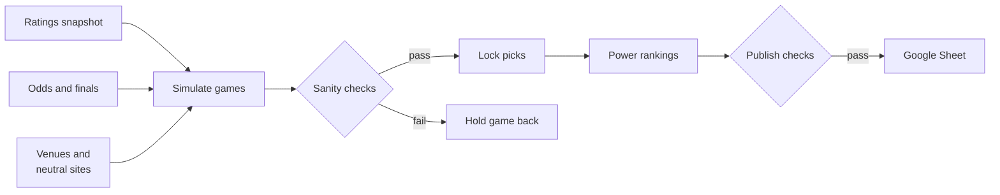

# Terrarium

A college basketball prediction engine for NCAA Division I men's basketball. Every morning it projects the day's games, compares them with the sportsbook lines, locks its picks before tip-off, ranks all 365 teams, and publishes everything to a Google Sheet. It then grades itself against the results and against Vegas.

The current system lives in [`v2/`](v2/). The original multi-agent LLM system is kept in [`v1/`](v1/) as legacy.

---

## How it works

Each game is projected in two parts rather than predicting a final score directly:

1. **Pace.** Expected possessions from both teams' adjusted tempos.
2. **Efficiency.** Points per 100 possessions for each team, from its adjusted offense against the opponent's adjusted defense, relative to the league average.

On top of that:

- **Home court** is worth about 2.6 points of margin. It is set to zero at neutral sites, which are identified from each day's venue data.
- An **early-season adjustment** widens rating gaps in November and December while ratings are still partly preseason.
- **Totals recalibration.** Projected pace and scoring level are pulled toward the league average (the raw formulas make totals too extreme), without changing the projected margin.
- **Correlated scoring noise.** Both teams' efficiencies are drawn with a shared component (ρ = 0.30), fitted so that margins and totals have the spreads seen in real games (about 11.4 and 17.3 points).

Each game is then simulated **10,000 times**, overtime included. The simulations give the projected score, spread, total, win probabilities and a margin-of-victory distribution. The model's spread is compared with the consensus line across up to 10 US sportsbooks. The side the model prefers is the pick. It is taken at the best line any book offers (line shopping), and the gap is the edge.

The **power rankings** order teams by the **Neutral Dominance Index (NDI)**: each team's expected win share if it played every other D-I team once on a neutral floor.

Full write-ups:

- [How the Daily Picks Work](v2/docs/how_picks_work.md): formulas, a worked example, safeguards and the backtest
- [How the Power Rankings Work](v2/docs/how_rankings_work.md): what NDI means and how it is calculated
- [ARCHITECTURE.md](v2/ARCHITECTURE.md): the original design specification

## Daily pipeline



`make daily` runs every step in order:

| Step | Command | What it does |
|---|---|---|
| Ingest | `cli.py ingest` | Stores today's team ratings as a dated snapshot |
| Odds | `cli.py odds` | Pulls spreads (with prices), moneylines, totals and final scores for up to 10 US sportsbooks from The Odds API |
| Venues | `cli.py venues` | Pulls venues and neutral-site flags from ESPN's scoreboard |
| Picks | `cli.py picks` | Simulates unlocked games, runs sanity checks, locks picks |
| Rankings | `cli.py power-rankings` | Computes NDI for every team |
| Publish | `cli.py publish` | Runs publish checks and writes all tabs to the Google Sheet |

On macOS, `make install-daily` installs a launchd job that runs the pipeline each morning. `make install-closing` adds odds-only pulls at 1:00 PM and 6:30 PM (`make closing`) so the ledger has real closing lines for closing-line value. Both jobs catch up after sleep. `make daily-status` and `make closing-status` show each job's state and last exit code.

## Design principles

- **No look-ahead.** Every projection and backtest uses only the ratings published on or before the morning of the game.
- **Picks are locked.** A pick is stored with the time it was made, the consensus line, and the line and book it was taken at. It is never overwritten, and the ledger grades it against that line. Closing-line value (CLV) tracks whether the pick beat the closing line. Model updates never re-make locked picks; each pick keeps the version that made it.
- **Catch structural errors before they publish.** Before a pick locks, the engine checks for:
  - team-name mismatches and odds attached to the wrong team;
  - stale ratings and duplicate teams;
  - impossible values;
  - implausible rank inversions.

  A game that fails is held back. Publishing is blocked if the ratings are stale, the rankings are inconsistent, or any cell would show a non-number.
- **Honest benchmarking.** Every metric is reported next to the same metric for the betting market.

## Outputs

The Google Sheet has desktop tabs and phone-friendly 📱 tabs:

| Tab | Contents |
|---|---|
| Daily Picks | Today's games: site and venue, projected score, model vs market spread and total, pick, pick line and book, edge, spread and over/under leans, win probabilities, margin distribution. Game Type, Spread Lean and O/U Lean columns are filterable |
| Historical Picks | Every locked pick with its line and book, closing line, CLV, final score and straight-up/ATS result |
| Model Performance & Stats | Accuracy, ATS record, error, Brier score and calibration, each compared with Vegas, with weekly trends |
| Daily Power Rankings | Rank, NDI, 7- and 30-day movement, trend sparkline and daily rank history |

## Track record

The 2025-26 backtest (model lean-v1.3) covered 3,383 regular-season games, each projected using only that morning's ratings:

| Measure | Model | Market |
|---|---|---|
| Picked the winner (games with a moneyline) | 68.5% | 68.9% |
| Against the spread, all picks | 50.5% | 52.4% needed to break even |
| Against the spread, edge 3+ points | 59.4% (286 games) | 52.4% needed to break even |
| Margin error (RMSE) | 11.31 pts | 11.27 pts |
| Brier score | 0.195 | 0.193 |
| Total error (RMSE) | 17.17 pts | 17.07 pts |

Overall the model is about as accurate as the betting market, not more accurate. Picks with an edge of 3+ points are the one promising signal, but they come from a single season with parameters fitted on that season, so 2026-27 is the real test. The over/under lean showed no edge. The live record is on the Model Performance tab.

## Getting started

Requires Python 3.11+.

```bash
cd v2
make setup     # creates .venv and installs requirements
make test      # runs the pytest suite
make simulate TEAM1="Kansas" TEAM2="Houston" VENUE=neutral
```

Credentials go in `v2/.env`. That file is git-ignored, so never commit it.

| Key | Used for |
|---|---|
| Ratings provider login | Daily ratings snapshot (see the ingest module for key names) |
| `ODDS_API_KEY` | The Odds API |
| `GOOGLE_SHEET_ID`, `GOOGLE_SERVICE_ACCOUNT_FILE` | Publishing to the sheet, using a service account with Editor access |
| `HOW_PICKS_DOC_ID`, `HOW_RANKINGS_DOC_ID` | Optional: Google Docs copies of the write-ups (`make docs`) |

Other useful commands:

```bash
.venv/bin/python cli.py odds --no-scores   # odds-only pull (3 credits), e.g. before tip-off
.venv/bin/python cli.py picks --relock     # re-lock unstarted picks after a fix
.venv/bin/python cli.py publish --force    # publish despite failed publish checks
.venv/bin/python cli.py state export DIR   # dump the warehouse to CSVs
```

## Repository layout

```text
terrarium/
├── v1/                     Legacy multi-agent LLM system (see v1/README.md)
└── v2/
    ├── cli.py              Typer CLI, one command per pipeline step
    ├── Makefile            setup, test, daily and per-step targets
    ├── ARCHITECTURE.md     Design specification
    ├── docs/               "How this works" papers
    ├── ops/                launchd jobs (daily pipeline, pre-tip odds pulls)
    ├── src/
    │   ├── db.py               DuckDB schema and connection
    │   ├── simulate_game.py    Monte Carlo game simulator
    │   ├── live_picks.py       Daily projections, pick locking, ledger
    │   ├── odds_api.py         Odds, consensus and best lines, closing lines, finals
    │   ├── venues.py           Venues and neutral sites
    │   ├── team_names.py       Team-name matching across feeds
    │   ├── sanity.py           Pre-lock and pre-publish checks
    │   ├── power_rankings.py   NDI rankings
    │   ├── scorecard.py        Performance metrics vs the market
    │   ├── validate_model.py   Backtesting
    │   ├── publish_gsheet.py   Google Sheet layout and publishing
    │   └── publish_docs.py     Google Docs publishing for the papers
    └── tests/              pytest suite
```

Data lives in `v2/data/`, which is git-ignored. It holds the DuckDB warehouse and cached raw responses.

## Legacy: v1

[`v1/`](v1/) holds the first version of Terrarium. It is a multi-agent system in which LLM agents researched games, made picks, assigned units and audited results. It is no longer maintained. See the [v1 README](v1/README.md) for its documentation.

---

*Terrarium is a statistical model built for entertainment and research. It is not betting advice.*
